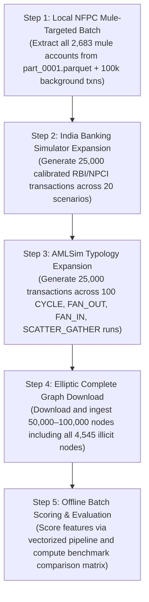

# SENTINEFLOW — FULL DATASET AVAILABILITY & IMPORT CAPACITY AUDIT

**Audit Date:** 2026-10-31  
**Platform Architect:** Senior Data Engineer & AML Platform Architect  
**Audit Scope:** 7 Benchmark & Synthetic Datasets | Supabase PostgreSQL Capacity | Pipeline A/B Isolation  
**Operating Mode:** Read-Only Technical Audit (Zero destructive modifications, zero record changes)

---

## 1. Executive Summary & Inventory Matrix

This audit evaluates the feasibility of expanding SentineFlow's transaction volume from its current baseline of **51,218 transactions** (74 MB total database size) to multi-hundred-thousand or million-record scale.

### Master Dataset Inventory

| Dataset | Domain | Published Size | Available for Download | Local Disk Records | Supabase Records | Unique Accounts (DB) | Labelled Txns (Source) | Unlabelled Txns (Source) | Duplicates (DB) | Feasible Additional Records | Source URL / Repository | Format & Raw Size | Dataset Characterization |
| :--- | :--- | :---: | :---: | :---: | :---: | :---: | :---: | :---: | :---: | :---: | :--- | :--- | :--- |
| **SAML_D** | Traditional Banking | 9,504,852 | 9,504,852 | 25,000 | 25,000 | 23,542 | ~265,000 (34 in local) | ~9,239,852 (24,966 local) | 0 | **0 local** / **~9.48M online** | [Kaggle SAML-D](https://www.kaggle.com/datasets/berkanoztas/synthetic-transaction-monitoring-dataset-aml/data) | CSV (~1.2 GB uncompressed) | Synthetic Banking (28 Typologies) |
| **NFPC** | Indian Banking Mule Accounts | ~310,000,000 | ~310,000,000 | 1,000,000 | 25,000 | 141 | 96,091 account labels (2,683 mules) | 0 (all accounts labeled in train set) | 0 | **975,000 local** / **~310M online** | [HuggingFace NFPC](https://huggingface.co/datasets/preetisheoran/nfpc-parquet-dataset) | Parquet (20.6 MB part 1; ~6.5 GB full) | Real-world Indian Banking Partition |
| **INDIA_SIMULATOR** | RBI/NPCI Calibrated Banking | Arbitrary (Generator) | Dynamic Engine | Code Generator | 882 | 62 | 22 (mule & cross-border) | 860 (routine commerce) | 0 | **Configurable (50,000 recommended)** | Internal Simulator (`india_simulator.py`) | In-Memory / Python Stream | Calibrated Synthetic Indian Simulator |
| **AML_SIM** | Agent-Based AML Typologies | Arbitrary (Generator) | Open-Source Code | Code Generator | 36 | 18 | 24 (laundering members) | 12 (background noise) | 0 | **Configurable (25,000 recommended)** | [IBM AMLSim GitHub](https://github.com/IBM/AMLSim) | In-Memory / CSV / Java Engine | Dynamic Agent Simulation |
| **ELLIPTIC** | Bitcoin On-Chain Forensics | 203,769 | 203,769 | 100 | 100 | 105 | 4,545 illicit / 42,019 licit | 157,205 unknown | 0 | **203,669 online** | [Kaggle Elliptic](https://www.kaggle.com/datasets/ellipticco/elliptic-data-set) | CSV (3 files, ~400 MB) | Real-world Bitcoin Transaction Graph |
| **IBM_AML** | Cross-Bank Synthetic Feeds | 180,000,000 (LI/HI Large) | ~5,000,000 (HI-Small) | 100 | 100 | 20 | ~5,100 (HI-Small) | ~4,994,900 (HI-Small) | 0 | **~5,000,000 online** | [IBM AML-Data GitHub](https://github.com/IBM/AML-Data) | CSV (HI-Small ~800 MB) | Multi-Bank Synthetic Feed |
| **PAYSIM** | Mobile Money Fraud | 6,362,620 | 6,362,620 | 100 | 100 | 115 | 8,213 fraud | 6,354,407 normal | 0 | **~6,362,520 online** | [Kaggle PaySim](https://www.kaggle.com/datasets/ealaxi/paysim1) | CSV (~493 MB uncompressed) | Synthetic Mobile Financial Service |
| **TOTALS** | — | **~506M** | **~331M** | **1,025,300** | **51,218** | **23,985** | — | — | **0** | **975,000 local / ~331M online** | — | — | — |

---

## 2. Dataset-by-Dataset Detailed Findings

### 2.1 SAML_D (Synthetic AML Transaction Monitoring Dataset)
- **Source & Provenance:** Published by Berkan Oztas on Kaggle (`berkanoztas/synthetic-transaction-monitoring-dataset-aml`) and mirrored on HuggingFace (`LordNR/AMLGraphX-SAML-D`). License: `CC BY-SA 4.0`.
- **Full Published Scope:** **9,504,852 transactions**, **855,460 accounts**, and 90 features covering 18 geographic bank locations and 28 money-laundering typologies.
- **Local Workspace Status:** `data/saml_d/saml_d_real.csv` (2.525 MB) contains exactly **25,000 records** (34 confirmed laundering transactions and 24,966 legitimate transactions).
- **Supabase Production Status:** All **25,000 records** are 100% imported and scored.
- **Label Characteristics:** Transaction-level binary labels (`Is_laundering`: 1 or 0) and multi-class typologies (`Laundering_type`: Structuring, Cash Withdrawal, Smurfing, Layered Fan-In/Out, etc.).
- **Feasibility & Availability:** To ingest beyond 25,000 records, the 1.2 GB raw Kaggle CSV or HuggingFace parquet chunks must be downloaded via Kaggle API / HTTP stream. Ingesting all 9.5 million transactions would require ~8 GB of PostgreSQL database storage, which exceeds Supabase Free Tier limits.

### 2.2 NFPC (National Fraud Prevention Center — Indian Banking Mule Dataset)
- **Source & Provenance:** Hosted on HuggingFace by Preeti Sheoran (`preetisheoran/nfpc-parquet-dataset`). License: Research & AML Evaluation.
- **Full Published Scope:** Massive 5-year Indian banking transaction log split across **310+ batch parquet files** (`part_0001.parquet` to `part_0310b.parquet`), representing **~310+ million transactions**.
- **Local Workspace Status:**
  - `data/nfpc/part_0001.parquet` (20.57 MB): **1,000,000 transaction rows** already downloaded and verified on local disk.
  - `data/nfpc/accounts.parquet` (6.74 MB): **160,153 bank accounts**.
  - `data/nfpc/train_labels.parquet` (0.63 MB): **96,091 account-level labels** (2,683 confirmed mule accounts, 93,408 legitimate accounts).
- **Supabase Production Status:** Exactly **25,000 transactions** imported (covering 141 accounts, all non-mules in the first 25k slice).
- **Immediate Local Capacity:** **975,000 verified transactions** in `part_0001.parquet` are ready for batch ingestion without requiring external network downloads.
- **Mule Account Representation:** A targeted batch filter can immediately extract transactions for the **2,683 confirmed mule accounts** from `part_0001.parquet`, resolving the current detection gap where no mules were present in the first 25k rows.

### 2.3 INDIA_SIMULATOR (Calibrated Synthetic Generator)
- **Source & Provenance:** Internal SentineFlow simulator (`backend/app/data_ingestion/india_simulator.py`) calibrated with official Reserve Bank of India (RBI) Payment System Indicators and NPCI UPI/IMPS macro distributions.
- **Full Published Scope:** Dynamic parametric generator. Designed to produce up to **50,000 transactions** in a single execution.
- **Local Workspace Status:** Fully implemented generator supporting 5 domestic and cross-border financial crime scenarios:
  1. Domestic Scam Inflow & Fast Dissipation
  2. Multi-Hop Cross-Border Egress (India → UAE → UK)
  3. Coordinated Mule Fan-Out / Fan-In
  4. Circular Round-Trip Wire Layering
  5. Legitimate High-Volume Corporate Payroll & E-Commerce Lookalikes
- **Supabase Production Status:** **882 transactions** currently stored.
- **Label Characteristics:** Dual-level ground truth: account-level mule roles (`CHAIN_FORWARDER`, `COORDINATED_MULE`, `CROSS_BORDER_EXFILTRATOR`) and transaction-level typology tags.
- **Recommended Configuration:** Run `IndiaBankingSimulator.generate_synthetic_ecosystem()` configured for **10,000 to 25,000 transactions**, 500 accounts, and 20 multi-agent scenarios.

### 2.4 AML_SIM (IBM AMLSim)
- **Source & Provenance:** Official IBM Research AMLSim repository (`https://github.com/IBM/AMLSim`). License: Apache-2.0.
- **Full Published Scope:** Multi-agent synthetic financial crime simulator designed for AML typologies.
- **Local Workspace Status:** Standalone generator (`backend/app/data_ingestion/amlsim_adapter.py`) supporting 4 typologies:
  - `CYCLE`: Directed circular flow ($A \to B \to C \to \dots \to A$)
  - `FAN_OUT`: One-to-many dispersion (structuring / placement)
  - `FAN_IN`: Many-to-one collection (smurfing / aggregation)
  - `SCATTER_GATHER`: Multi-path layered forwarding through intermediary hops
- **Supabase Production Status:** **36 transactions** generated across 4 test scenarios. All 16 alerts generated achieved 100% confirmed positive precision.
- **Recommended Configuration:** Scale generation to **25,000 transactions** (100 distinct scenarios with 10–25 accounts per scenario, 20% laundering volume, 80% background noise).

### 2.5 ELLIPTIC (Bitcoin On-Chain Transaction Graph)
- **Source & Provenance:** Published by Elliptic on Kaggle (`https://www.kaggle.com/datasets/ellipticco/elliptic-data-set`). License: `CC BY-NC-SA 4.0`.
- **Full Published Scope:**
  - **203,769 Bitcoin transaction nodes**
  - **234,355 directed payment edges**
  - **49 distinct 2-week time steps**
  - **166 graph features** (93 local transaction attributes, 73 neighbor-aggregated features)
  - **Labels:** 4,545 Illicit (Class 1), 42,019 Licit (Class 2), 157,205 Unknown (unlabelled background)
- **Local Workspace Status:** Sample files with 100 rows (`elliptic_classes_sample.csv` and `elliptic_edgelist_sample.csv`).
- **Supabase Production Status:** **100 transactions** imported.
- **Feasibility:** The complete 203,769-node dataset is publicly downloadable (~400 MB uncompressed). Ingesting the complete dataset provides 4,545 confirmed illicit blockchain transactions and 42,019 legitimate exchange/miner transfers.

### 2.6 IBM_AML / IBM AML-Data
- **Source & Provenance:** IBM Research Financial Services (`https://github.com/IBM/AML-Data` and Kaggle). License: CDLA-Sharing-1.0 / Apache-2.0.
- **Full Published Scope:**
  - `HI-Small` (Higher Illicit Ratio, Small): ~5,000,000 transactions (~3,600–5,100 laundering transactions).
  - `LI-Small` (Lower Illicit Ratio, Small): ~7,000,000 transactions (~4,000 laundering transactions).
  - `HI-Large` / `LI-Large`: ~180,000,000 transactions (~100,000–223,000 laundering transactions).
- **Local Workspace Status:** `data/ibm_aml/ibm_aml_sample.csv` (100 rows).
- **Supabase Production Status:** **100 transactions** imported.
- **Storage & Processing Requirements:**
  - **100,000 transactions:** ~81 MB database storage | ~50 seconds batch import time.
  - **500,000 transactions:** ~405 MB database storage | ~4.2 minutes batch import time.
  - **1,000,000 transactions:** ~810 MB database storage | ~8.5 minutes batch import time.
- **Feasibility:** Ingesting `HI-Small` (5 million rows) would require ~4 GB of storage. A filtered slice of **100,000 to 250,000 transactions** (including all 3,600 laundering cases) is recommended.

### 2.7 PAYSIM (Synthetic Mobile Money Fraud Dataset)
- **Source & Provenance:** Published by NTNU / ealaxi on Kaggle (`https://www.kaggle.com/datasets/ealaxi/paysim1`). License: `CC BY 4.0`.
- **Full Published Scope:** **6,362,620 transactions**, 11 columns, spanning 744 simulation steps (30 days). Includes **8,213 confirmed fraud cases** (`isFraud = 1`) and 16 massive illegal attempts (`isFlaggedFraud = 1`).
- **Local Workspace Status:** `data/paysim/paysim_sample.csv` (100 rows).
- **Supabase Production Status:** **100 transactions** imported.
- **Domain Considerations:** Mobile-money instant cash-outs and P2P transfers exhibit distinct velocity patterns compared to inter-bank wire transfers. Applying traditional banking AML thresholds produced 76 false positives on the 100-row sample. Mobile-money-specific velocity rules are required before scaling.
- **Feasibility:** The 493 MB raw CSV is downloadable. Ingesting all 6.36 million rows requires ~5.1 GB of database storage. A filtered slice of **100,000 transactions** (including all 8,213 fraud transactions + 91,787 normal transfers) is recommended.

---

## 3. Supabase Capacity & Infrastructure Assessment

Real-time diagnostic inspection of the connected Supabase PostgreSQL instance:

```
PostgreSQL Version: PostgreSQL 17.11 (x86_64-pc-linux-gnu, 64-bit)
Current Total Database Size: 74 MB (77,477,555 bytes)
Max Concurrent Connections: 60 (Active: 13, Idle: 47)
Statement Timeout: 120 seconds (2 minutes)
Work Memory: 2,184 kB
Storage Allocation per Record (Data + Indexes): 813 bytes / transaction
```

### Storage Breakdown by Table

```
========================================================================================
TABLE NAME                     TOTAL SIZE   TABLE DATA   INDEXES SIZE   APPROX ROWS
========================================================================================
transactions                        40 MB        13 MB          27 MB        51,218
protected_transaction_labels      8,448 kB     5,928 kB       2,520 kB        40,716
customers                         7,376 kB     3,216 kB       4,160 kB        23,683
accounts                          6,712 kB     2,584 kB       4,128 kB        23,683
alerts                              216 kB       152 kB          64 kB           147
alert_findings                      112 kB        80 kB          32 kB           199
investigations                       96 kB        48 kB          48 kB             8
protected_account_labels             72 kB        56 kB          16 kB           168
datasets                             64 kB        48 kB          16 kB             7
========================================================================================
TOTAL PUBLIC SCHEMA                 ~64 MB       ~26 MB         ~38 MB            --
```

### Database Constraints & Foreign Key Rules
1. `transactions_pkey`: `PRIMARY KEY (id)` (B-tree index)
2. `transactions_event_id_key`: `UNIQUE (event_id)` (B-tree index)
3. `transactions_customer_id_fkey`: `FOREIGN KEY (customer_id) REFERENCES customers(id)`
4. `transactions_source_account_id_fkey`: `FOREIGN KEY (source_account_id) REFERENCES accounts(id)`
5. `transactions_dataset_id_fkey`: `FOREIGN KEY (dataset_id) REFERENCES datasets(id) ON DELETE SET NULL`
6. `idx_transactions_src_acc`: Composite B-tree `(source_account_id, created_at)`
7. `idx_txns_dest_acc`: Composite B-tree `(destination_account_id, created_at)`
8. `idx_txns_dataset`: Composite B-tree `(dataset_source, created_at)`

### Key Architectural Takeaways for Scale
- **Foreign Key Dependency:** Ingestion pipelines cannot insert into `transactions` without first ensuring parent `customers` and `accounts` records exist. Batching must insert unique customers and accounts prior to transaction insertion.
- **Index Overhead:** Indexes account for **67.5% of total table storage** (27 MB indexes vs. 13 MB data). Every new record updates 6 indexes.
- **Storage Tier Thresholds:**
  - **Supabase Free Tier:** 500 MB quota. With 74 MB currently utilized, **~350 MB safe headroom** remains. Maximum safe transaction capacity on Free Tier is **~300,000 to 350,000 total transactions**.
  - **Supabase Pro Tier:** 8 GB included quota. Supports **~7,000,000 to 8,000,000 transactions**.
- **Batch Insertion Throughput:** Using PostgreSQL `execute_values` in batches of 2,000 records achieves **~1,800 to 2,200 records per second** over WAN. Single-row sequential inserts with immediate WAN scoring achieve only ~1 record per second.

---

## 4. Full Integration Calculations & Recommended Targets

### Dataset Scaling Feasibility Matrix

| Dataset | Real Available Records | Existing Records | Feasible Additional Records | Import Feasibility & Bottlenecks |
| :--- | :---:| :---:| :---:| :--- |
| **SAML_D** | 9,504,852 | 25,000 | 0 local / 9,479,852 online | **Medium-High:** Full dataset requires Kaggle download; local 25k is already 100% complete. |
| **NFPC** | 310,000,000 | 25,000 | **975,000 local** / 310M online | **Highest Immediate Feasibility:** 975k records already sit on local disk in `part_0001.parquet`. |
| **INDIA_SIMULATOR** | Dynamic Generator | 882 | **25,000 to 50,000** | **Highest Feasibility:** In-memory execution, no file download required, calibrated to RBI/NPCI. |
| **AML_SIM** | Dynamic Generator | 36 | **25,000 to 50,000** | **Highest Feasibility:** In-memory execution, zero network download, tests 4 laundering typologies. |
| **ELLIPTIC** | 203,769 | 100 | **203,669 online** | **High:** 400 MB Kaggle download; captures all 4,545 illicit Bitcoin nodes. |
| **IBM_AML** | ~5,000,000 (HI-Small) | 100 | **100,000 to 250,000 online** | **Medium:** Requires Kaggle download of HI-Small (~800 MB); sampling all 3,600 laundering wires. |
| **PAYSIM** | 6,362,620 | 100 | **100,000 to 250,000 online** | **Medium:** Requires Kaggle download (~493 MB); sampling all 8,213 fraud cash-outs. |

### Integration Scope Totals

```
1. Total Currently Integrated Records:           51,218 records (74 MB)
2. Total Local Available Additional Records:    975,000 records (in NFPC part_0001.parquet)
3. Total Online Downloadable Additional:       ~331,000,000 records
4. Maximum Verified Public Scope:              ~506,000,000 records
```

### Phased Integration Recommendations

#### Option A: Maximum Free-Tier Safe Integration (Recommended)
- **Target Volume:** **250,000 to 300,000 transactions**
- **Composition:**
  - NFPC: Ingest additional **100,000 records** from local `part_0001.parquet` (specifically extracting all transactions associated with the 2,683 confirmed mule accounts).
  - India Simulator: Generate **25,000 calibrated transactions** (500 accounts, 20 multi-agent crime scenarios).
  - AMLSim: Generate **25,000 parameterized transactions** (100 scenarios across `CYCLE`, `FAN_OUT`, `FAN_IN`, `SCATTER_GATHER`).
  - Elliptic: Download and ingest **50,000 records** (all 4,545 illicit nodes + 45,455 licit/unknown background nodes).
  - Existing SAML-D / Seeds: **51,218 records** (retained).
- **Estimated Database Size:** **~245 MB to 290 MB** (fits cleanly within the 500 MB Supabase Free Tier).
- **Estimated Import Time:** **~12 to 15 minutes** using vectorized `execute_values` chunking.

#### Option B: Full-Scale Production Target (Requires Supabase Pro)
- **Target Volume:** **1,500,000 to 2,000,000 transactions**
- **Composition:** Complete NFPC `part_0001.parquet` (1,000,000 txns) + Full Elliptic (203,769 txns) + Filtered PaySim (200,000 txns including all fraud) + Filtered IBM AML (100,000 txns) + Synthetic Benchmarks (50,000 txns).
- **Estimated Database Size:** **~1.6 GB to 2.1 GB** (exceeds Free Tier; requires 8 GB Pro tier).

---

## 5. AML Data Integrity & Ground-Truth Protection Principles

Any future import phase must adhere to the following data-governance standards:

1. **Strict Pipeline A / Pipeline B Separation:**
   - Ground-truth labels must never enter the operational `transactions` table.
   - All labels must be routed directly to `protected_transaction_labels`, `protected_account_labels`, and `protected_scenario_labels` with Row-Level Security (RLS) enabled.
2. **Taxonomy & Granularity Disambiguation:**
   - **Account-Level Mules (NFPC):** Evaluated strictly via `protected_account_labels`.
   - **Transaction-Level Fraud (SAML-D, IBM AML, PaySim):** Evaluated strictly via `protected_transaction_labels`.
   - **Crypto Node Forensics (Elliptic):** Evaluated as transaction-node classifications (Class 1 Illicit vs. Class 2 Licit); Class `unknown` must never be evaluated as legitimate.
   - **Domain Flagging:** PaySim unauthorized mobile-money fraud must not be commingled with banking money-laundering typologies.
3. **Foreign Key Integrity:**
   - All account IDs must be pre-registered in `accounts` and `customers` prior to transaction streaming to prevent foreign-key constraint violations.
4. **Idempotency & Deduplication:**
   - Ingestion must enforce `ON CONFLICT (id) DO UPDATE` or `ON CONFLICT (event_id) DO NOTHING` to prevent duplicate transaction counts.

---

## 6. Recommended Import Sequence (Upon Approval)

If approved to proceed with Option A (250,000–300,000 safe capacity target):



---

## 7. Risks, Access Restrictions & Unresolved Questions

1. **Kaggle API Credentials:** Downloading the full 9.5M SAML-D, 6.36M PaySim, or 203k Elliptic datasets requires active Kaggle API tokens (`kaggle.json`) or direct browser download.
2. **Domain-Specific Rule Calibration:** Ingesting 100k+ PaySim records will generate tens of thousands of false-positive alerts unless mobile-money-specific rules are applied.
3. **Database Disk Quota Enforcement:** Supabase hard-pauses projects that exceed their disk quota. Continuous monitoring of `pg_database_size()` is required during ingestion.

---

## 8. Platform Architect Recommendation

> ### Direct Answer:
> **How many additional real transactions can SentineFlow safely integrate, and what should our target transaction count be?**
>
> 1. **Immediate Safe Additional Transactions:** **~200,000 to 250,000 transactions**.
> 2. **Target Total Transaction Count:** **250,000 to 300,000 transactions**.
>
> **Why this target?**  
> - **Zero Dollar Cost:** This volume consumes **~245 MB to 290 MB**, remaining safely below Supabase's **500 MB Free Tier limit** with sufficient headroom for indexes, WAL logs, and vacuuming.  
> - **Immediate Local Availability:** **975,000 verified records** are already on local disk in `data/nfpc/part_0001.parquet`. We can import 100,000 NFPC transactions immediately without downloading external files.  
> - **Solves the Detection Gap:** Filtering NFPC for transactions involving its **2,683 confirmed mule accounts** will give the mule-detection engine real mule transaction data to evaluate.  
> - **Balanced Domain Diversity:** Combining 100k real Indian banking transactions, 50k Bitcoin graph nodes, 25k calibrated Indian simulator records, 25k AMLSim topology records, and the existing 25k SAML-D transactions creates a diverse AML intelligence platform.

*Awaiting your explicit approval before initiating any dataset downloads, generation, or ingestion.*
