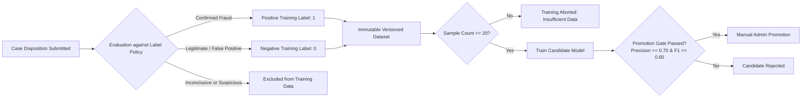

SentinelFlow AI — Feedback & Controlled Continuous Learning
The Feedback Poisoning Problem
In conventional machine learning systems, alerts that trigger are often erroneously assumed to represent fraud ground truth, leading to catastrophic feedback loops and escalating false positives.
SentinelFlow AI implements a strict, policy-governed learning workflow:

Promotion Gates
Minimum Distinct Samples: At least 20 human-verified labeled examples.
Minimum Class Representation: At least 5 positives and 5 negatives.
Holdout Evaluation: 70/30 chronological split.
Performance Thresholds: Precision must be ≥ 0.70, F1 ≥ 0.60.
Explicit Authorization: Model promotion requires fraud_admin or senior_investigator permission.
Instant Rollback: 1-click rollback to baseline scoring model in case of drift.
